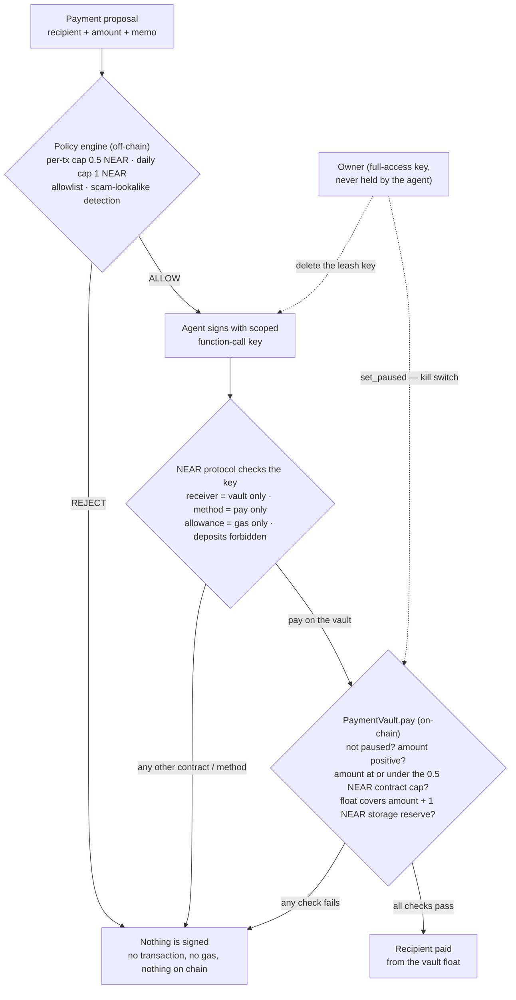

# AgentLeash

### Give an AI agent money — without giving it the keys to everything.

**A policy-guarded wallet for AI agents on NEAR: an off-chain policy engine, a capped
vault contract, and a scoped function-call key — so a compromised agent can only ever
spend a small float, in small chunks, to approved recipients.**

`NEAR testnet` · `vault.agentleash2026.testnet` · `Rust (near-sdk 5)` · `MIT`
 
NEAR HACKATHON — AI Security & Defense · Agent Economy

---

## Why it matters

An AI agent that can pay needs a wallet. But a normal wallet key is all-or-nothing:
whoever holds it — the agent, a prompt injection, a buggy tool call — can send
**everything, anywhere, instantly**.

AgentLeash replaces that single point of failure with three independent layers.
No single layer is trusted: the policy engine is advisory, the vault contract
enforces its own cap in code, and the agent's key is restricted by the NEAR
protocol itself. If the agent is prompt-injected, buggy, or fully compromised,
the worst case is bounded — at most the vault's float, in ≤ 0.5 NEAR chunks,
through one contract method — and the owner can pause the vault or delete the
key at any time.

## Live deployment (NEAR testnet)

| Role | Account |
| --- | --- |
| Owner ("the human") | `agentleash2026.testnet` |
| Agent account | `agent.agentleash2026.testnet` |
| PaymentVault contract | `vault.agentleash2026.testnet` |
| Allowlisted merchant | `shop.agentleash2026.testnet` |
| Scam lookalike (demo target) | `shops.agentleash2026.testnet` |

Testnet only — no real funds are involved anywhere in this repository.

## Architecture

**Layer 1 — Policy engine (off-chain, `src/policy.js`).** Every proposed payment
is screened before anything is signed: per-transaction cap (0.5 NEAR), daily cap
(1 NEAR, tracked in the agent's own spend ledger at `state/spend-ledger.json`),
a recipient allowlist, and scam-lookalike detection (a recipient within edit
distance ≤ 2 of an allowlisted address — after normalising lookalike characters
such as `0`→`o` and `1`→`l` — is rejected as a probable scam). A rejection means
no transaction is ever created.

**Layer 2 — Vault contract (on-chain, `contract-rs/payment-vault/`).** Payments
are made by a small Rust contract (`PaymentVault`) out of a capped **float**,
never from the main wallet. The contract itself enforces a hard per-payment cap
and keeps a 1 NEAR storage reserve back from every payment.

**Layer 3 — Scoped function-call key (on-chain, enforced by NEAR).** The agent
process only holds a function-call access key that can call **one method**
(`pay`) on **one contract** (the vault), with a small gas-only allowance
(1 NEAR). It cannot transfer NEAR, cannot call any other contract or method,
and cannot attach a deposit — the protocol enforces all of this, not our code.

The agent's leash key (public):
`ed25519:5ZZqCk2mygvpJRVi1pjR1kvLmHy7iZwPqAW7DzxgxP8D` — on-chain permission:
receiver `vault.agentleash2026.testnet`, methods `["pay"]`, allowance 1 NEAR.
Verify it yourself:
<https://explorer.testnet.near.org/accounts/agent.agentleash2026.testnet>

## What the vault enforces

From `contract-rs/payment-vault/src/lib.rs` — every `pay` call must pass all of
these, in the contract, on chain:

- **Not paused** — the owner-only pause switch is off (`assert!(!self.paused, …)`).
- **Positive amount** — zero or negative payments are rejected.
- **Per-payment cap** — `amount <= max_per_payment_yocto`; the cap was set to
  **0.5 NEAR** at initialisation and cannot be raised by the agent.
- **Float + reserve** — the contract balance must cover the payment **plus** a
  1 NEAR storage reserve that is always kept back, so a payment can never drain
  the contract below its storage needs.
- **Owner-only pause** — `set_paused` asserts the caller is the vault owner;
  the agent's key is not even permitted to name the method (proof D below).

And around the contract:

- The **key** can only call `pay` on this one contract, with a gas-only
  allowance — it carries no deposit and no transfer rights.
- The **policy engine** additionally enforces the 1 NEAR daily cap, the
  recipient allowlist, and lookalike rejection before anything is signed.

## Why a float? A NEAR protocol finding

The obvious design — the agent attaches a deposit to each `pay` call through
its function-call key — is **impossible on NEAR**: function-call access keys
cannot attach deposits. We proved this on testnet; the chain rejects such a
call with `AccessKeyDepositWithFunctionCallActionError` ("Deposit is not
allowed with function call"). See `evidence/deposit-restriction-discovery.json`.
The float pattern is the standard answer: fund a small escrow contract once,
let the leashed key direct payments out of the float.

## On-chain proofs

Seven checks, run against the live testnet deployment by
`node scripts/prove-leash.js` and recorded in `evidence/leash-proof.json`
(reference run: 2026-11-11):

| # | Check | On-chain result |
| --- | --- | --- |
| A | Leash key permissions as stored on chain | Function-call key: receiver `vault.agentleash2026.testnet`, methods `["pay"]`, allowance ≈ 0.9992 NEAR at recording time (issued at 1 NEAR, gas-only; earlier proofs had spent a little gas). A second micro-leash key was issued at 0.001 NEAR for proof E. |
| B | Allowed payment succeeds | 0.1 NEAR paid to `shop.agentleash2026.testnet`; the key's allowance fell by gas only (≈ 0.0002 NEAR). Tx: [`D6BoU6earsLH4E8EcVu8gfLcNnVgcJrq8tvrPbRnW3XQ`](https://explorer.testnet.near.org/transactions/D6BoU6earsLH4E8EcVu8gfLcNnVgcJrq8tvrPbRnW3XQ) |
| C | Call to a different contract | Rejected by the protocol: `AccessKeyReceiverMismatchActionError` |
| D | Call to the forbidden method `set_paused` | Rejected by the protocol: `AccessKeyMethodNameMismatchActionError` |
| E | Micro-allowance key (0.001 NEAR) tries to pay | Rejected by the protocol: `AccessKeyNotEnoughAllowanceActionError` |
| F | Payment above the contract cap | The vault's own cap assertion rejects it: `ContractExecutionError` (the recorded 0.75 NEAR attempt is in the evidence file) |
| G | Vault stats after the proofs | `payment_count = 4`, `total_paid = 0.7 NEAR`, `max_per_payment = 0.5 NEAR`, contract balance ≈ 2.7993 NEAR, `paused = false` |

## Policy demo

Three proposals through the real agent CLI stack, recorded in
`evidence/demo.json` — also presented as a standalone page in
[`docs/index.html`](docs/index.html):

| # | Proposal | Outcome |
| --- | --- | --- |
| 1 | 0.25 NEAR → `shop.agentleash2026.testnet` (allowlisted merchant) | **ALLOW** — broadcast. Tx: [`6v5sZEN2GpQNHxx1yjHPrxxk5Rn1E5dBJpQUqDuAFpcX`](https://explorer.testnet.near.org/transactions/6v5sZEN2GpQNHxx1yjHPrxxk5Rn1E5dBJpQUqDuAFpcX) |
| 2 | 0.75 NEAR → `shop.agentleash2026.testnet` | **REJECT** — exceeds the 0.5 NEAR per-transaction cap (and the daily cap, with 0.5 NEAR already spent that day). No transaction created. |
| 3 | 0.10 NEAR → `shops.agentleash2026.testnet` (note the extra "s") | **REJECT** — scam lookalike of the allowlisted merchant (edit distance ≤ 2). No transaction created. |

Vault stats after the demo: `payment_count = 3`, `total_paid = 0.6 NEAR`,
contract balance ≈ 2.8993 NEAR.

## Quickstart

Prerequisites: Node.js 20+, then `npm install` in this directory. Testnet RPC
is occasionally slow; the scripts retry.

The demo accounts and keys in `.keys/` are **testnet throwaways** created for
this hackathon. The folder is gitignored, so a fresh clone must run the setup
steps (`node scripts/setup-accounts.js`, `node scripts/deploy-vault.js`,
`node scripts/make-leash.js`) or provide its own testnet accounts.

1. **Check the deployment.**
   `node scripts/check-balances.js`
   → The five accounts with their NEAR balances (owner ≈ 10 NEAR at start).
2. **See the leash proofs.**
   `node scripts/prove-leash.js`
   → Runs the seven on-chain checks in the proofs table above and writes
   `evidence/leash-proof.json`.
3. **Run the agent demo.**
   `node scripts/demo.js`
   → The three proposals in the policy demo table above; full output is
   saved to `evidence/demo.json`.
4. **Use the agent yourself.**
   `node src/agent.js propose --to shop.agentleash2026.testnet --amount 0.1 --memo "coffee"`
   → `POLICY ALLOW`, then `SENT tx …` with an explorer link.
   Try `--amount 0.9` or the lookalike address and watch it refuse
   (exit code 2, nothing signed).
5. **Owner kill switches (owner key required).**
   Pause the vault: call `set_paused { "paused": true }` on
   `vault.agentleash2026.testnet` — subsequent `pay` calls fail.
   Or delete the agent's leash key — the agent can no longer sign at all,
   while its full-access key never left the owner's hands.

## Security model in one paragraph

Trust is minimized layer by layer. The policy engine is *advisory*: if it is
bypassed, the vault still caps each payment at 0.5 NEAR and can only spend its
float; if the vault had a bug, the key still cannot make it do anything except
call `pay`; and the agent's key can never move the main wallet's funds, deploy
code, manage keys, or stake. Deleting one key or pausing one contract fully
stops the agent. This is what NEAR's function-call keys and sub-accounts are
for — AgentLeash packages them into a wallet an AI can actually be trusted with.

## Repository layout

- `contract-rs/payment-vault/` — the vault (Rust, near-sdk 5). An earlier
  near-sdk-js build worked but produced a 531 KB wasm (≈ 5.3 NEAR of deploy
  storage); the Rust build is 87 KB. The JS source is kept in `contract/src/`.
- `src/policy.js` — the policy engine (caps, allowlist, lookalike detection,
  daily spend ledger).
- `src/agent-core.js` / `src/agent.js` — propose → check → sign (scoped key
  only) → broadcast.
- `scripts/` — account setup, deployment, key issuance, proofs, demo.
- `evidence/` — the recorded outputs of the reference runs quoted above.
- `docs/index.html` — a standalone page presenting the policy demo.

## Built with

- near-sdk 5 (Rust) for the contract; near-api-js 7 for the agent/scripts;
  near-cli-rs for faucet account creation. All standard NEAR tooling.
- No templates for the agent/policy code — written for this hackathon
  (window per the rules: code since the 2026-10-19 announcement counts).

## License

MIT — see LICENSE.

> Sibling entry (same builder, independent project, disclosed per the
> hackathon rules): **RitualCoin** — a memecoin with an on-chain ritual
> mechanic (NEAR HACKATHON, Memecoins With Mechanics track).
